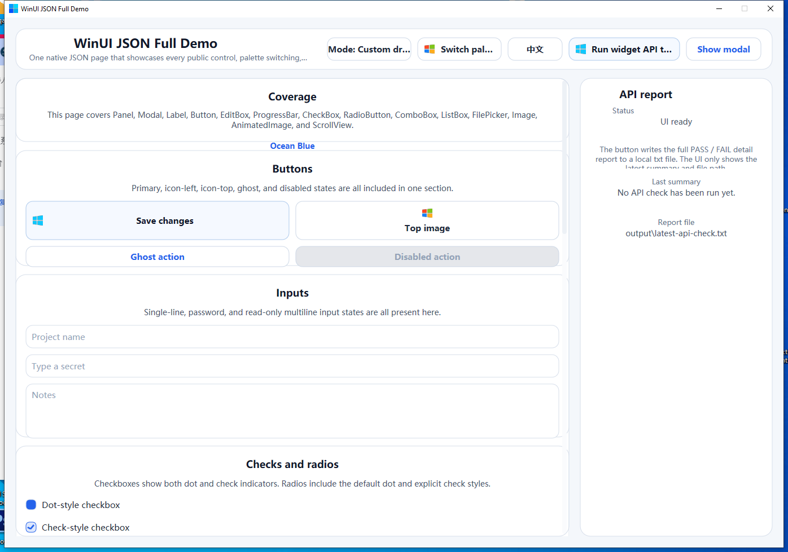
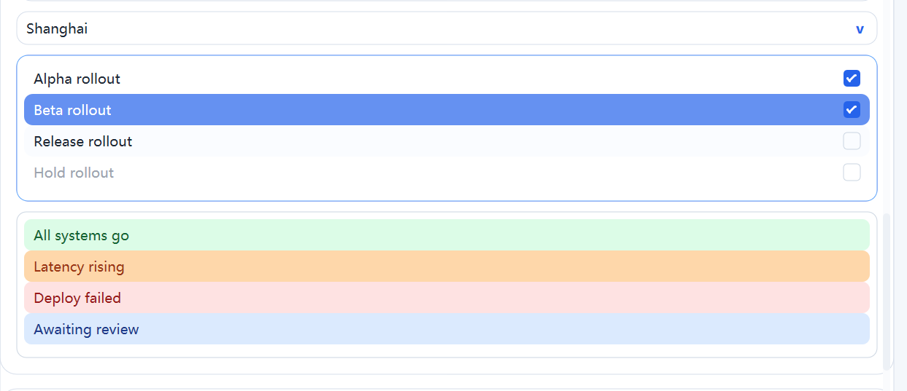
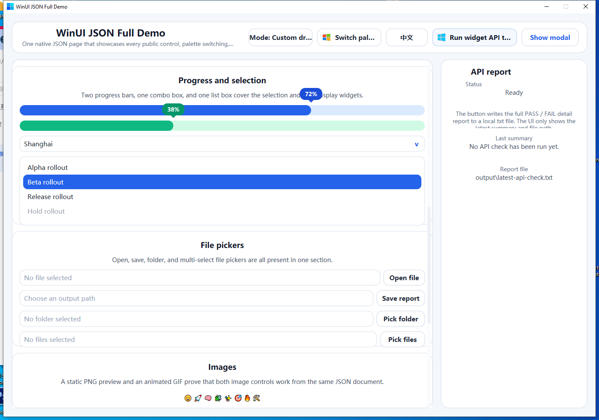
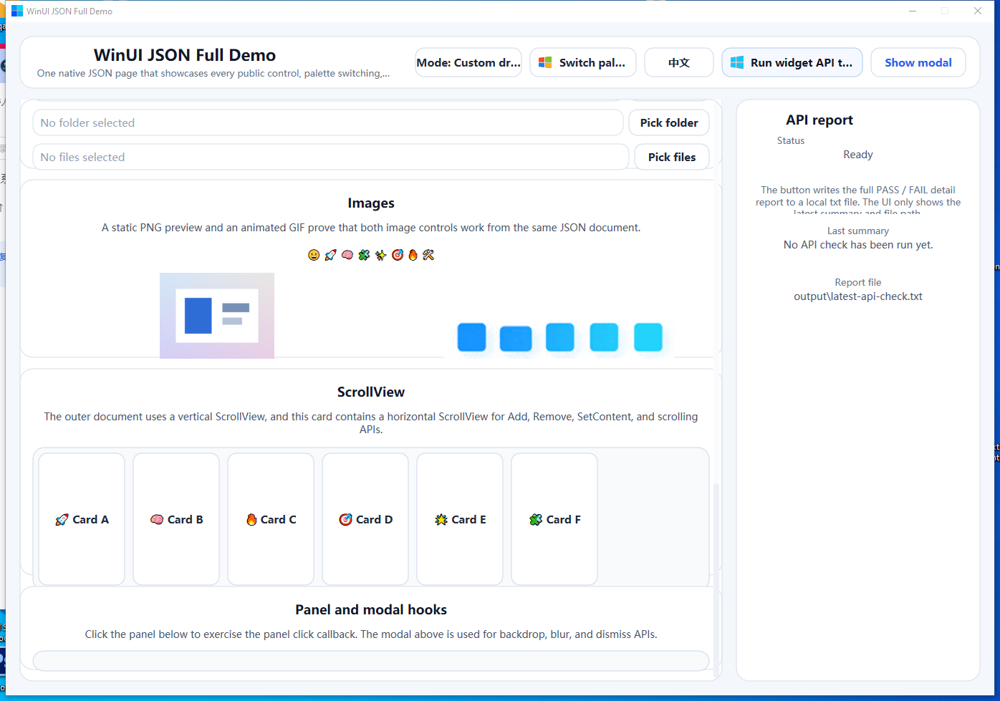

# winui

`winui` is a Windows-only Go UI toolkit built directly on top of Win32.

It targets native desktop tools that need explicit control over window lifecycle, painting, DPI, input, reusable widgets, and a declarative JSON UI layer without WebView, XAML, or cross-platform wrappers.

Chinese version: [README.zh-CN.md](./README.zh-CN.md)

## Features

- Windows only
- Clear `core` / `widgets` / `sysapi` split
- `RenderModeAuto`: prefer Direct2D, fall back to GDI
- Direct2D text rendering keeps Windows color fonts such as emoji when `cgo` is enabled
- Window and button image resources accept PNG / JPG / JPEG / GIF (GIF uses the first frame only); window images still become native `HICON` internally
- Retained widget scene tree with themes and layouts
- Reusable built-in controls
- Native open / save / folder dialogs in `sysapi`
- Declarative JSON UI loader in `widgets/jsonui`
- JSON UI component templates with a top-level registry and argument-based instantiation
- DPI-aware JSON frame expressions with `+`, `-`, `*`, `/`, `()`, `%`, and window/parent size variables
- State-driven bindings through `jsonui.DataSource`
- JSON text inputs with `readOnly`, `multiline`, wrapping, and scroll flags
- Declarative multiline `label` with width-constrained auto-height measurement
- Declarative `modal` / backdrop support with Direct2D-only blur tint
- Declarative `scrollview` for JSON-authored nested scrolling surfaces
- Runtime lookup helpers such as `Window.FindWidget`, `Document.FindWidget`, and `widgets.FindByID`
- Single-window and multi-window helpers
- Hidden startup and non-activating window placement, visibility and Z-order operations
- Consumable scene keyboard previews, including native RichEdit input and IME-safe shortcuts
- Two-line `ListBox` rows using `ListItem.Subtitle` and a configured item height
- Demo apps in `demo/demo_json_full` and `demo/demo_go_full`

## Packages

- `core/`: window lifecycle, paint, DPI, input, timer, image, icon, font
- `sysapi/`: Windows system API helpers, including native file dialogs
- `widgets/`: scene tree, event routing, layout, theme, controls
- `widgets/jsonui/`: JSON schema loader, bindings, expressions, multi-window helpers
- `demo/demo_json_full/`: full-surface JSON UI demo with palette switching and API checks
- `demo/demo_go_full/`: full-surface Go UI demo with palette switching, mode toggling, and API checks

## Quick Start

For companion windows, set `core.Options.StartHidden = true`, call `app.Init()`,
then use `app.SetScreenBounds(core.Rect{...})`, `app.RaiseNoActivate()` and
`app.ShowNoActivate()`. Screen bounds use physical pixels and include the window
frame. These methods, `Hide()`, `ScreenBounds()` and `SetOwner(...)` run synchronously
on the UI thread and return operation errors. `Init` starts the message pump;
`Run` waits for its completion. A stopped pump returns `core.ErrAppClosed`.
Avoid holding a lock needed by UI callbacks while calling a synchronous method.

`App.Post` guarantees that a callback will never execute if posting returns an
error. Success accepts the callback (or executes it inline on the UI thread);
termination of the UI loop can still cancel accepted work.

`SetOwner` uses ordinary Win32 ownership: minimizing the owner hides the owned
window, and destroying the owner destroys it. Use `RaiseNoActivate` for independent
windows that should stay alive after an external window closes. It raises within
the current Z-order group without making a normal window globally topmost.

Use `scene.FocusWidget(widget)` for explicit widget focus and
`scene.SetKeyPreview(func(core.KeyEvent) bool)` (or `SceneHooks.OnKeyPreview`) for
shortcuts. Returning `true` consumes the key before character generation, including
when a native child owns focus. `KeyEvent` includes `Ctrl`, `Shift`, `Alt`, `Repeat`
and `Composing`; IME composition bypasses shortcut handlers. Ordinary unconsumed
keys continue through the existing callbacks and controls. Native window chrome
and click-to-activate behavior remain available.

Expanded custom combo boxes handle their local navigation and dismissal keys
before scene/core shortcut previews. Escape closes the list first; a later Escape
can reach the application. Tab and modified shortcuts retain application preview
handling. Vertical wheel input within an open list scrolls its visible rows independently
of the selected item and never scrolls the underlying form at a list boundary.
Unsupported horizontal input can bubble to a capable ancestor.
Scene events bubble once from the target to its ancestors, so an inner control
can consume input before an outer scroll view handles it.

For opt-in Tab navigation, call `scene.FocusNext(key.Shift)` from the UI-thread
key preview when `key.Key == core.KeyTab` and neither Ctrl nor Alt is held. It
wraps in depth-first child order, skips hidden/disabled ancestors, and stays in
the topmost visible enabled modal. It returns false if no eligible target exists
or it is called off the UI thread. No global Tab behavior is installed.

`FocusWidget` and `FocusNext` reveal off-viewport targets through ancestor
`ScrollView` offsets before transferring focus. Nested viewports use nearest-edge
movement; fully visible targets stay still, including oversized targets already
covering a viewport. Native editor hosts keep their full editing bounds and use
cached window regions to clip drawing and clicks to those same ancestor viewports.
Mouse focus uses the same native focus transfer as explicit and Tab focus.
Only explicit/Tab focus scrolls to reveal a target; mouse focus keeps the clicked
geometry unchanged until the original pointer event is interpreted. Editor text
set before scene attachment is seeded into the new native host before change
notifications are registered, preserving initial drafts in both editor modes.

Custom buttons participate in focus traversal. A focused, enabled button invokes
`OnClick` once for an unmodified Enter or Space press; repeats, modifiers and IME
composition do not activate it. Its inset focus outline uses the resolved text
color for contrast on both light and solid-color themes. Native buttons retain
their Windows keyboard handling.

Unconsumed native editor submit keys use that same pre-translation path, so
`OnSubmit` cannot leave a translated CR/LF behind when key messages accumulate.
`KeyEvent.Handle` identifies the source window. IME-wrapped ordinary keys are
resolved before translation, while active composition still bypasses shortcuts.

Set `ListStyle.ItemHeightDP` to a suitable two-line height (for example, 56 DP with
the default font) to display `ListItem.Subtitle`. Compact rows keep single-line
text. Existing selection, clipping, scrolling, checks and activation are shared.

Imperative widgets:

```go
package main

import (
	"github.com/AzureIvory/winui/core"
	"github.com/AzureIvory/winui/widgets"
)

func main() {
	opts := core.Options{
		ClassName:      "ExampleApp",
		Title:          "winui example",
		Width:          800,
		Height:         600,
		Style:          core.DefaultWindowStyle,
		ExStyle:        core.DefaultWindowExStyle,
		Cursor:         core.CursorArrow,
		Background:     core.RGB(255, 255, 255),
		DoubleBuffered: true,
		RenderMode:     core.RenderModeAuto,
	}

	widgets.BindScene(&opts, widgets.SceneHooks{
		OnCreate: func(_ *core.App, scene *widgets.Scene) error {
			label := widgets.NewLabel("title", "Hello winui")
			label.SetBounds(widgets.Rect{X: 24, Y: 24, W: 240, H: 32})
			scene.Root().Add(label)
			return nil
		},
	})

	app, err := core.NewApp(opts)
	if err != nil {
		panic(err)
	}
	if err := app.Init(); err != nil {
		panic(err)
	}
	app.Run()
}
```

JSON UI:

```go
store := jsonui.NewStore(map[string]any{
	"page": map[string]any{
		"title": "JSON Demo",
	},
})

win, err := jsonui.LoadFileIntoScene(scene, "demo.ui.json", jsonui.LoadOptions{
	Data: store,
})
if err != nil {
	panic(err)
}

title := win.FindWidget("title")
_ = title

store.Set("page.title", "Updated Title")
```

```json
{
  "wins": [
    {
      "id": "main",
      "title": { "bind": "page.title", "default": "Fallback" },
      "w": 980,
      "h": 720,
      "root": {
        "type": "panel",
        "layout": "abs",
        "children": [
          {
            "type": "label",
            "id": "title",
            "text": { "bind": "page.title" },
            "frame": { "x": 20, "y": 20, "w": 320, "h": 28 }
          }
        ]
      }
    }
  ]
}
```

## JSON UI Model

- Top-level `wins` declares one or more windows
- Top-level `components` can register reusable external component templates relative to `LoadOptions.AssetsDir`
- JSON declares widget trees, styles, actions, and bindings
- Host code owns all data mutation through `jsonui.DataSource`
- A component instance node uses `component` + `args` and expands to one widget subtree before normal loading begins
- A component instance node may also pass `slots`, and templates may splice named slot arrays into `children`
- Template files define `component`, `params`, and `node`
- Placeholders must occupy the entire JSON value, for example `"${title}"`; partial string interpolation such as `"btn-${id}"` is rejected
- Frame values are logical DP by default and scale with DPI
- Widget DPI behavior stays backward compatible by default; no `scale` config means the legacy all-DP model
- Use `widgets.SetScalePolicy(...)` in Go or a node-level JSON `scale` field to opt individual nodes into `px`, mixed slot policies, or both
- Widget ids must stay unique within each declared window
- Bool fields fall back to widget semantics when omitted or when a bound value is missing: `visible` / `enabled` stay `true`, while `checked`, `multiple`, and `autoplay` stay `false`
- `input` / `textarea` support `readOnly`, `multiline`, `wordWrap`, `acceptReturn`, `verticalScroll`, and `horizontalScroll`
- `window.image`, `button.image`, and `image` controls accept static PNG / JPG / JPEG / GIF input; GIF uses the first frame only
- `LoadOptions.ImageSizeDP`, per-window `imageSizeDP`, per-node `imageSizeDP`, and `style.imageSize` control the image slot size
- `style.shape` now supports `default` and `pill` for buttons; `pill` uses half the button height as the final corner radius
- `ComboBox` now supports `ComboStyle.Layout` (`default` / `rich`) in custom mode; rich layout can render item icon + title + subtitle
- JSON `select.items[]` now accepts `subtitle` and `image`; rich layout style keys include `layout`, `subtitleFg`, `iconBg`, and `mark`
- Button borders can be removed by setting `style.border` to `transparent` in JSON, or `ButtonStyle.Border` to `0` in an explicit override
- Image rendering keeps the original aspect ratio and fits with contain semantics instead of stretching to a square
- Images are cached by target pixel size and quality; Direct2D bitmaps are preferred, with GDI as fallback when needed
- Use `animimg` when you need animated GIF playback
- The loader does not guarantee BMP, SVG, WEBP, AVIF, or ico-specific loading semantics
- `label` supports `multiline` and `wordWrap`, including auto-measured height when width is constrained
- `modal` supports `backdrop.color`, `backdrop.opacity`, `backdrop.blur`, `backdrop.dismissOnClick`, and `onDismiss`
- `frame` supports `x`, `y`, `r`, `b`, `w`, `h`
- Expressions support integer arithmetic with `+`, `-`, `*`, `/`, and parentheses
- Variables are limited to `winW`, `winH`, `parentW`, and `parentH`
- Percent literals such as `"50%"` keep the legacy axis-based window percentage semantics
- Example expressions include:
  - `100`
  - `"50%+12"`
  - `"(parentW - 12*3 - 20*2 - 108) / 4"`
  - `"(parentW-184)/4"`

## File Dialogs

Go API:

```go
result, err := sysapi.ShowFileDialog(app, sysapi.Options{
	Mode:        sysapi.DialogOpen,
	Title:       "Open a file",
	Filters:     []sysapi.FileFilter{{Name: "Text Files", Pattern: "*.txt;*.md"}},
	MultiSelect: true,
})
if err != nil {
	panic(err)
}
_ = result.Paths
```

JSON UI:

```json
{
  "type": "file",
  "id": "openFile",
  "dialog": "open",
  "buttonText": "Open...",
  "dialogTitle": "Open a source file",
  "accept": ["*.txt", "*.md", "*.go"]
}
```

## Multi-Window

`jsonui.Document` keeps every declared window.

- `doc.PrimaryWindow()` returns the first one
- `doc.Window("tools")` looks up by id
- `win.FindWidget("status")` looks up a widget inside one window
- `doc.FindWidget("main", "status")` looks up across windows
- `ActionContext.Window` points back to the runtime window in action handlers
- `doc.NewApps(baseOpts)` creates one `core.App` per window
- `jsonui.MountWindow(scene, win)` creates a `WindowHost` for mount / replace / detach hot reload flows
- `jsonui.RunApps(...)` starts every hosted window and waits for all loops to exit

## Run Demos

```powershell
go run ./demo/demo_json_full
go run ./demo/demo_go_full
```

## Demo Screenshots

JSON full demo UI snapshots:






## Validation

```powershell
go test ./...
go test -v ./demo/demo_json_full
go test -v ./demo/demo_go_full
go vet ./...
go run ./demo/demo_json_full
go run ./demo/demo_go_full
```

GitHub Actions mirrors the Windows validation path in `.github/workflows/ci.yml` with `gofmt`, dedicated `go test -v ./demo/demo_json_full` and `go test -v ./demo/demo_go_full` regression steps, an upload of `demo/demo_json_full/output/latest-api-check.txt`, plus `go test ./...` and `go vet ./...` under both `CGO_ENABLED=0` and `CGO_ENABLED=1`.

## Docs

- [README.zh-CN.md](./README.zh-CN.md): Chinese landing page
- [DEVELOPING.md](./DEVELOPING.md): maintainer rules, architecture boundaries, validation
- [WIDGETS.zh-CN.md](./WIDGETS.zh-CN.md): widget and JSON UI overview
- [JSONUI.zh-CN.md](./JSONUI.zh-CN.md): Chinese end-user guide for the JSON DSL
- [AGENTS.md](./AGENTS.md): compact repository guide
- [AI_CHANGELOG.md](./AI_CHANGELOG.md): behavior changes that affect future edits

## Native Mode Note

`Button`, `EditBox`, `CheckBox`, `RadioButton`, `ComboBox`, and `FilePicker` can switch between custom-drawn and native-system backends via the `mode` parameter.

Multiline `EditBox` hosts use the padded content viewport in both modes. RichEdit formats against its actual client area, including native scrollbar space, so internal scrolling cannot leave text fragments in the widget padding or border.

If you want `ModeNative` controls to render with Win10/Win11 visual styles, the final executable still needs a `Microsoft.Windows.Common-Controls` v6 manifest.

## 紧凑知识工作台键盘语义（2026-10-29）

`ListBox.SetShowCheck(true)` 时，聚焦的有效选中行可用不带修饰键的 Space 切换勾选。勾选通过现有 `OnCheckChange` 回调报告，不改变单选项，不触发 `OnChange` 或 `OnActivate`。按键自动重复只消费，不重复切换；Ctrl/Alt/Shift、IME 组合、禁用/隐藏项不参与勾选。该操作复用 Scene 的 TranslateMessage 前默认键阶段；即使回调转焦点到原生编辑器，旧 Space 也不会作为字符漏入新编辑器。应用不应模拟第二套勾选键盘循环。

`EditBox.Composing() bool` 是 UI 线程上的只读原生 IME 状态查询。需要延迟搜索的宿主可在去抖回调中检查它，组合期间等待，组合结束后再按需发起后台工作。它复用已有原生组合状态，不执行网络/文件访问，也不启动额外消息循环。JSON UI 的 ListBox `showCheck` 自动采用上述通用 Space 行为；组合状态查询是 Go 宿主 API，无需新的 JSON 字段。

## Width-constrained measurement

`widgets.MeasureForWidth(widget, width) core.Size` exposes the existing layout measurement path. Width and result use physical pixels; pass `app.DP(...)` for a logical column width. Call it on the UI thread after attaching the widget to its scene, so the current theme, font and DPI apply. A nil widget measures zero; nonpositive width uses natural measurement.

Existing explicit preferred dimensions remain authoritative. For an automatically growing Label, enable `SetMultiline(true)` and `SetWordWrap(true)` and leave preferred height unset before measuring. `SetPreferredSize` uses logical DP, so convert measured pixels when recording logical sizes. See [the widget guide](WIDGETS.zh-CN.md#受宽测量) for the full contract.

## Dynamic scrolling and wheel axes

`ScrollView` invalidates its measured content size when descendants change children, layout data, explicit geometry or preferred size. Label text, wrapping and font/format changes also invalidate ancestor scroll measurements. The next layout, paint or scroll input recomputes both ranges at the existing viewport size; scrolling and hover keep using the measured cache. Use the setters on the UI thread rather than changing exported fields directly.

Row, column and linear natural/constrained measurements follow their existing layout visibility rules: hidden children contribute neither size nor gaps. Scroll boundary measurement ignores hidden children's retained bounds; callers do not need to erase hidden geometry when toggling visibility.

Both native wheel messages use `OnMouseWheel`. `core.MouseEvent.Horizontal` and `widgets.Event.Horizontal` distinguish `WM_MOUSEHWHEEL` from the default vertical axis without changing raw `Flags` or signed `Delta`. A positive horizontal delta moves right; a positive vertical delta moves up. Shift + vertical wheel keeps its existing horizontal preference. True horizontal input only moves the horizontal axis and bubbles when unsupported or at its edge; vertical-only ListBox and EditBox handlers leave it for a capable ancestor.

Scrollbar track and thumb colors derive from `PanelStyle.Background` and `BorderColor`. Leave the border color unset to use the default contrasting palette when setting a white background; setting both colors to white also makes the derived scrollbar white.
